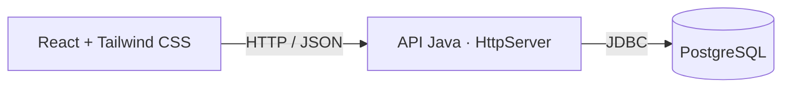

# Habit Tracker

**BRICK BY BRICK, DAY BY DAY.**

Aplicação full stack para acompanhar hábitos e registrar o humor ao longo do mês. A ideia nasceu de um habit tracker físico: cada linha representa um hábito, cada coluna representa um dia, e um gráfico abaixo da tabela mostra os registros de humor.

O projeto reúne **React, Tailwind CSS, Java sem framework e PostgreSQL**, com uma identidade visual inspirada em papel, tons de vinho e mostarda e um ícone de bonfire.


## Funcionalidades

- Cadastro, login e logout com sessão por cookie.
- Criação, edição, ordenação e encerramento de hábitos diários.
- Tabela mensal com navegação entre meses e anos.
- Marcações de concluído, não realizado ou sem registro.
- Histórico e percentual de conclusão por hábito.
- Registro diário de humor em cinco níveis, com gráfico mensal.
- Dados separados por usuário e validação das regras no backend.
- Interface responsiva com rolagem horizontal na tabela.

## Tecnologias

| Camada | Tecnologias |
| --- | --- |
| Frontend | React 19, JavaScript, Tailwind CSS 4 e Vite 6 |
| Backend | Java 21+, HttpServer do JDK, JDBC e Jackson |
| Banco de dados | PostgreSQL e migrações SQL |
| Autenticação | Cookies HttpOnly, tokens de sessão e PBKDF2-HMAC-SHA256 |
| Testes | JUnit 5, Node.js Test Runner e testes HTTP em PowerShell |
| Ferramentas | Maven, pnpm e Prettier |
| Interface | Lucide React, SVG e fontes locais via Fontsource |
| Deploy | Docker, Render e PostgreSQL no Neon |

### Java sem framework

O backend utiliza o `HttpServer` do JDK. O roteamento, as validações, as sessões e as transações estão implementados diretamente no código Java. O acesso ao PostgreSQL usa JDBC com consultas parametrizadas, e o Jackson faz a leitura e a escrita de JSON.



## Regras de negócio

- Hábitos continuam nos meses seguintes até a data final de acompanhamento.
- Cada hábito aceita apenas uma marcação por dia. Deixar uma célula vazia significa **sem registro**, não uma falha.
- Datas futuras e dias fora do período do hábito ficam bloqueados.
- Alterações de período que excluiriam marcações existentes são rejeitadas, preservando o histórico.
- O progresso considera os dias previstos já decorridos, incluindo o dia atual. A data de hoje segue o fuso horário do usuário.
- O humor é opcional e independente dos hábitos. Dias sem registro ficam sem ponto no gráfico.

## Executando localmente

### Pré-requisitos

- JDK **21 ou superior** e Maven **3.9 ou superior**.
- Node.js **22 ou superior**.
- **pnpm 11+** ou npm.
- PostgreSQL com `psql`, `initdb` e `pg_ctl` disponíveis no `PATH`.
- PowerShell **7** para utilizar os scripts de desenvolvimento e testes HTTP.

Os comandos abaixo devem ser executados a partir da raiz do repositório, após cloná-lo.

### 1. Instalar as dependências do frontend

```powershell
cd frontend
pnpm install --frozen-lockfile
cd ..
```

Também é possível usar `npm install` na pasta `frontend`. O lockfile versionado no projeto é o `pnpm-lock.yaml`.

### 2. Iniciar o banco e o backend

No primeiro terminal:

```powershell
./scripts/Start-Database.ps1
./scripts/Start-Backend.ps1
```

O script prepara um PostgreSQL exclusivo do projeto em `.tools/postgres-data`, na porta **55432**, e aplica o esquema na primeira execução. Os dados são preservados entre reinicializações. A API utiliza uma conta sem privilégios administrativos.

As variáveis de conexão são definidas no terminal pelo script. Execute os dois comandos na mesma sessão. O Maven resolve as dependências Java durante a inicialização do backend.

Se os binários do PostgreSQL não estiverem no `PATH`, informe a pasta da sua instalação:

```powershell
./scripts/Start-Database.ps1 -PostgresBin 'C:\Program Files\PostgreSQL\18\bin'
```

### 3. Iniciar a interface

Em outro terminal, na raiz do repositório:

```powershell
./scripts/Start-Frontend.ps1
```

Acesse **[http://localhost:5173](http://localhost:5173)** e crie uma conta. A API atende em `http://localhost:8080`, e o Vite encaminha as requisições `/api` para ela.

Para encerrar, use `Ctrl+C` nos terminais dos servidores e execute:

```powershell
./scripts/Stop-Database.ps1
```

<details>
<summary><strong>Utilizando um PostgreSQL já configurado</strong></summary>

Nesse caso, crie um banco vazio e aplique a migração com uma conta responsável pelo esquema:

```powershell
psql -h localhost -U SEU_USUARIO -d habit_tracker -v ON_ERROR_STOP=1 -f database/migrations/001_initial_schema.sql
```

Configure uma conta de aplicação com permissões de leitura e escrita nas tabelas e uso das sequências. Ela não precisa de privilégios para administrar o banco ou alterar o esquema.

Defina a conexão e inicie o backend:

```powershell
$env:DB_URL = 'jdbc:postgresql://localhost:5432/habit_tracker'
$env:DB_USER = 'SEU_USUARIO_DA_APLICACAO'
$dbCredential = Get-Credential -UserName $env:DB_USER -Message 'Senha do PostgreSQL'
$env:DB_PASSWORD = $dbCredential.GetNetworkCredential().Password
./scripts/Start-Backend.ps1
```

A migração deve ser aplicada uma única vez em um banco vazio. O servidor Java não executa migrações automaticamente.

</details>

### Configuração

| Variável | Descrição | Padrão |
| --- | --- | --- |
| `DATABASE_URL` | URI PostgreSQL do Neon; tem precedência sobre `DB_*` e exige TLS com certificado validado | Opcional |
| `DB_URL` | URL JDBC do PostgreSQL local | Obrigatória sem `DATABASE_URL` |
| `DB_USER` | Usuário da aplicação no banco | Obrigatória sem `DATABASE_URL` |
| `DB_PASSWORD` | Senha do banco | Obrigatória sem `DATABASE_URL` |
| `APP_PORT` / `PORT` | Porta HTTP; `APP_PORT` tem precedência | `8080` |
| `APP_HOST` | Endereço de escuta | `127.0.0.1`; `0.0.0.0` no Docker |
| `FRONTEND_DIR` | Diretório do build React servido pelo Java | Opcional; `/app/public` no Docker |
| `APP_ORIGIN` | Origem permitida para as requisições | `RENDER_EXTERNAL_URL` no Render; `http://localhost:5173` localmente |
| `COOKIE_SECURE` | Envio de cookies apenas por HTTPS | Ativado por padrão para origens HTTPS |

O arquivo [`backend/.env.example`](backend/.env.example) documenta a configuração. O Java lê variáveis de ambiente; arquivos `.env` não são carregados automaticamente. Credenciais, dados locais e arquivos gerados ficam fora do versionamento.

## Deploy gratuito

O [`Dockerfile`](Dockerfile) compila frontend e backend e os executa em um único serviço, com usuário sem privilégios administrativos. O [`render.yaml`](render.yaml) configura um Web Service gratuito no Render, conectado a um banco externo no Neon.

O passo a passo para criar o banco, aplicar a migração, configurar a conta da aplicação e publicar está em **[docs/DEPLOY.md](docs/DEPLOY.md)**. As credenciais são informadas nas variáveis privadas do Render. O serviço gratuito pode suspender por inatividade e demora para responder na primeira visita; consulte os limites no guia.

## Estrutura do projeto

```text
Habit Tracker/
├── backend/
│   └── src/
│       ├── main/java/br/com/habittracker/
│       │   ├── config/       # Configuração por variáveis de ambiente
│       │   ├── database/     # Conexões JDBC
│       │   ├── domain/       # Regras de datas e progresso
│       │   ├── http/         # Rotas e respostas da API
│       │   └── security/     # Senhas, sessões e limites de autenticação
│       └── test/            # Testes Java
├── frontend/
│   └── src/
│       ├── components/      # Login, tabela, gráfico e formulários
│       ├── api.js           # Cliente HTTP
│       ├── calendar.js      # Datas e níveis de humor
│       ├── fonts.css        # Fontes locais
│       └── styles.css       # Paleta e layout
├── database/migrations/     # Esquema PostgreSQL
└── scripts/                 # Execução local e testes HTTP
```

## Testes e build

**Backend:**

```powershell
mvn -f backend/pom.xml test
```

**Frontend:**

```powershell
cd frontend
pnpm test
pnpm format:check
pnpm build
```

Os mesmos scripts podem ser executados com `npm test` e `npm run <script>`.

**Integração e segurança da API**, a partir da raiz, com banco e backend em execução:

```powershell
./scripts/Test-Api.ps1
./scripts/Test-Security.ps1
```

Os testes HTTP utilizam contas temporárias. Mantenha as variáveis `DB_*` definidas no terminal para permitir a limpeza dessas contas ao final. Execute os testes no banco de desenvolvimento; repetições em sequência podem atingir o limite de autenticação de 15 minutos.

## API

Prefixo: `/api`. As requisições e respostas utilizam JSON; as datas seguem `YYYY-MM-DD`.

| Recurso | Rotas principais |
| --- | --- |
| Autenticação | `POST /auth/register`, `POST /auth/login`, `POST /auth/logout`, `GET /auth/me` |
| Consulta mensal | `GET /tracker?year=2026&month=10` |
| Hábitos | `POST /habits`, `PATCH /habits/{id}`, `DELETE /habits/{id}` |
| Ordenação | `PUT /habits/order` |
| Marcações | `PUT` e `DELETE /habits/{id}/entries/{date}` |
| Humor | `PUT` e `DELETE /moods/{date}` |
| Diagnóstico | `GET /health` (com banco), `GET /health/live` (somente processo) |

As rotas de hábitos, marcações, humor e consulta mensal exigem uma sessão autenticada. Respostas de erro incluem `code` e `message`.

## Segurança e estado do projeto

O MVP permite acompanhar hábitos e humor com contas separadas. A aplicação utiliza senhas com hash e salt individual, cookies HttpOnly e SameSite, validação de origem, limites de autenticação e consultas SQL parametrizadas. O servidor dos arquivos de produção aplica uma Content Security Policy e bloqueia caminhos fora do build.

A configuração do Render exige HTTPS e cookies seguros. Os limites de autenticação no Render são globais por instância e por conta, sem confiar em cabeçalhos de IP do visitante. Recuperação de senha, confirmação de email e limites compartilhados entre instâncias ainda não estão implementados. Os controles e os limites da revisão estão documentados em [`SECURITY.md`](SECURITY.md).

## Identidade visual

A interface combina fundo de papel quente, vinho e mostarda com **Fraunces** nos títulos, **Manrope** nos textos e **IBM Plex Mono** nos números. A bonfire é um SVG simplificado inspirado na referência de Dark Souls.

As fontes são servidas localmente. Suas licenças OFL estão em [`frontend/public/fonts/licenses`](frontend/public/fonts/licenses).
